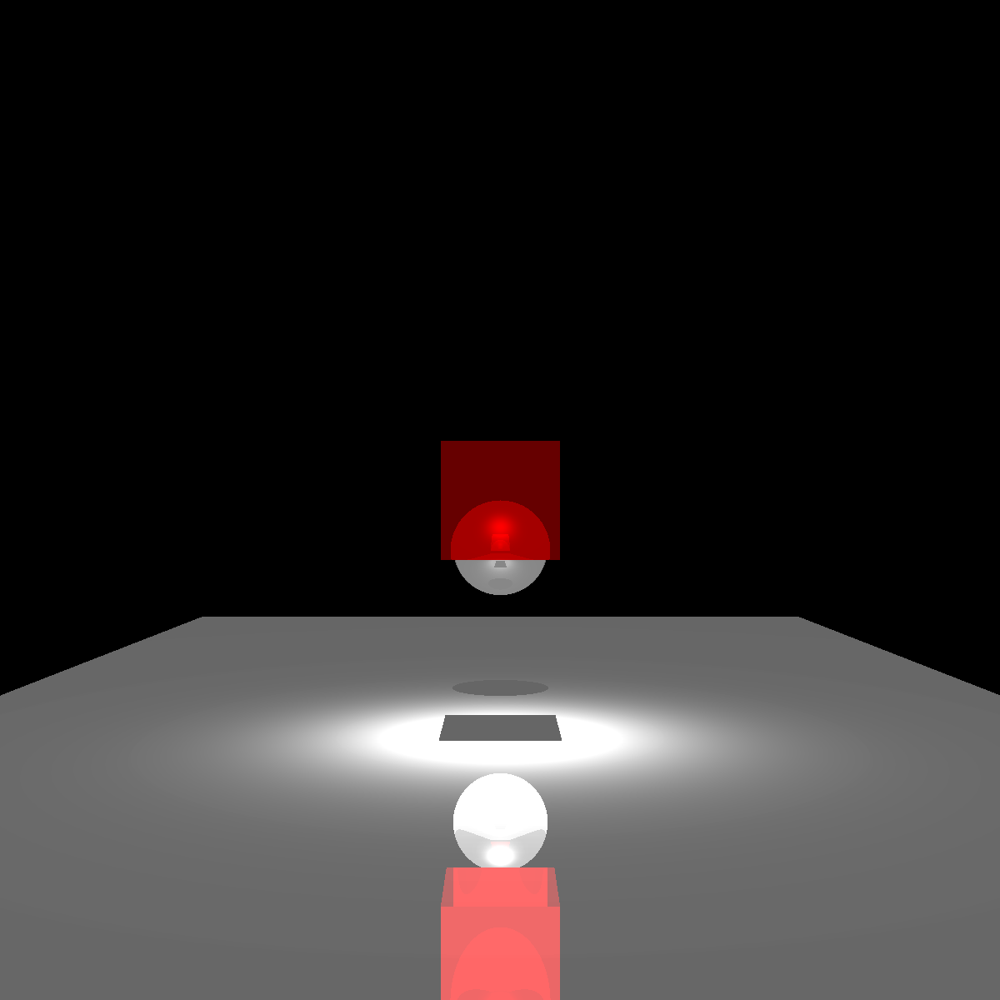
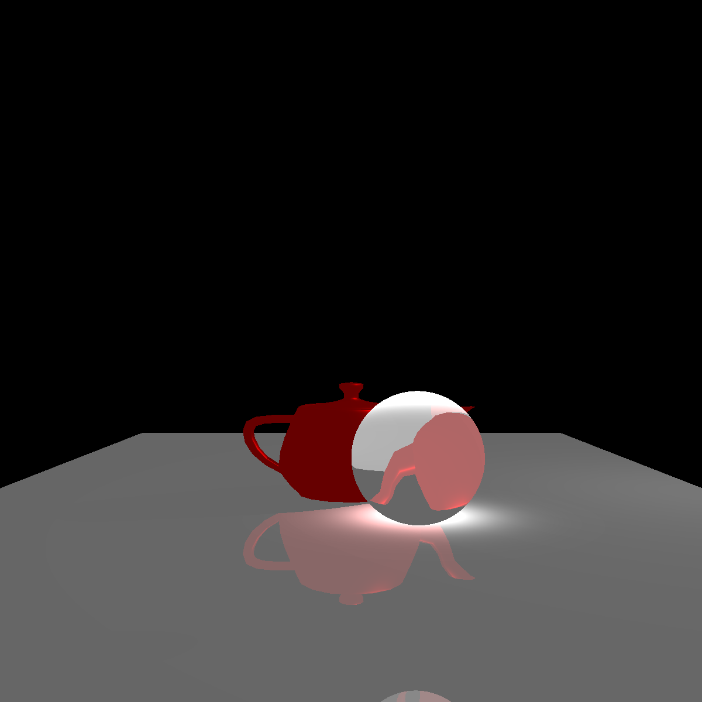
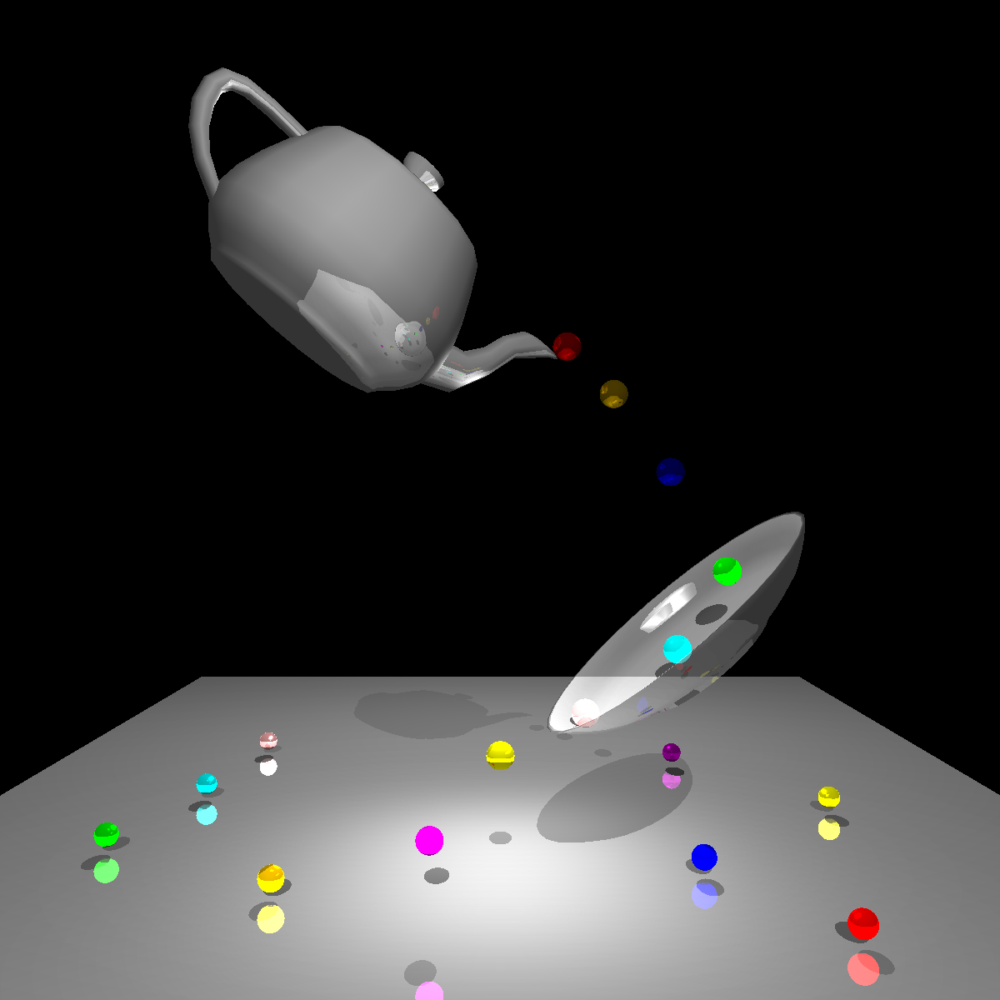

# Ray Tracer – Java

A custom ray tracer developed entirely from scratch in **Java** as part of the **Multimedia & Computer Graphics** course (May–June 2021). This project implements fundamental ray tracing techniques from the ground up to render 3D scenes featuring realistic lighting, shadows, reflections, and material interactions.

---

## ✨ Features

- **Geometry:** Supports ray-sphere intersections and complex OBJ mesh parsing.
- **Shading:** Implements the Blinn–Phong illumination model, including ambient, diffuse, and specular components with configurable shininess.
- **Lighting:** Supports multiple directional and point light sources.
- **Shadows:** Precision shadow ray calculations for realistic occlusion.
- **Reflections:** Recursive reflective surface interactions.
- **Refractions:** Refractive surface interactions handling light bending through transparent materials.

---

## 🖼️ Rendered Results

The following images showcase scenes rendered using the implemented ray tracer:

| Scene 1 | Scene 2 | Scene 3 |
| :---: | :---: | :---: |
|  |  |  |
---

## 🛠️ Technologies

- **Language:** Java
- **Core Concepts:** Ray Tracing, Blinn–Phong Illumination Model, 3D Vector Math
- **Asset Support:** OBJ 3D Models

---

## 🎓 Academic Context

This project was developed for the **Multimedia & Computer Graphics** course, part of the Bachelor's Degree in Computer Graphics and Systems Engineering at **Universidad Panamericana** (May–June 2021).
